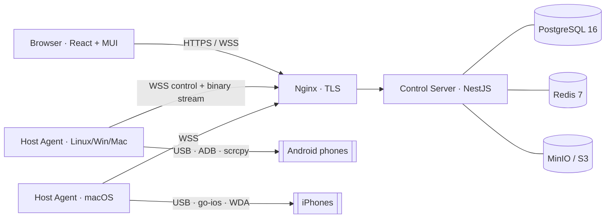

# DeviceLab

An on-premises remote mobile device lab. QA engineers reserve a real Android or
iOS phone from the browser, watch its screen live, tap, swipe and type on it,
install builds, read logs and capture screenshots. It is like a private
BrowserStack or AWS Device Farm, built to run inside a bank's or IT company's
own network, with RBAC and an audit trail on every action.

_Crafted by Vaibhav Sonawane through Claude_

| Phase                           | Scope                                                                                                                                        | Status |
| ------------------------------- | -------------------------------------------------------------------------------------------------------------------------------------------- | ------ |
| 0 Foundation                    | Monorepo, schema, auth, RBAC, audit, Docker Compose, portal shell                                                                            | ✅     |
| 1 Android MVP                   | Host agent (ADB + scrcpy), live inventory, reservations, live H.264 session with full input, hardware keys, APK install, logcat, screenshots | ✅     |
| 2 iOS                           | go-ios + WebDriverAgent driver (interface ready, stub in place)                                                                              | ⏳     |
| 3 Builds, recording, automation | Metadata parsing, recordings, Appium, CI API tokens                                                                                          | ⏳     |
| 4 Enterprise                    | OIDC/LDAP, booking calendar, dashboards, retention jobs, WebRTC                                                                              | ⏳     |

## Architecture



- **JSON control** over Socket.IO (`/portal`, `/agent`), typed in `packages/shared-types`.
- **Binary video and input** over plain WebSockets (`/ws/stream/*`) using the
  framing in `packages/protocol`. The server relays frames without transcoding
  and enforces the **single-writer rule**: only the reservation holder can send
  input, and observers are view-only.
- **H.264** from scrcpy-server is decoded in the browser with **WebCodecs**
  (JMuxer/MSE as fallback). iOS will use MJPEG from WebDriverAgent.

See [docs/ARCHITECTURE.md](docs/ARCHITECTURE.md) for the protocol, sequences and design notes.

```
apps/portal        React 18 + Vite + MUI v6 web portal
apps/server        NestJS control server (REST, Socket.IO, stream relay, Prisma)
apps/host-agent    Node 20 agent for device hosts (Android driver, mock driver, iOS stub)
packages/shared-types  DTOs, enums, permission matrix, WebSocket contracts (Zod)
packages/protocol  Binary frames, scrcpy control encoders, H.264 SPS parser
packages/ui        Shared MUI theme, DeviceCard, ScreenViewer, LogPanel
packages/config    tsconfig / ESLint presets
infra/             docker-compose, Nginx (TLS + CSP), host bootstrap scripts
docs/              Architecture, host setup, security
```

## Quick start (development, no phones needed)

Prerequisites: Node 20+, pnpm 10, PostgreSQL 16 and Redis 7 (local or via
Docker), and `ffmpeg` (optional; lets the mock Android devices stream real H.264).

```bash
pnpm i
# Postgres + Redis for development (ports on 127.0.0.1, creds match apps/server/.env.example):
docker compose -f infra/docker-compose.dev.yml up -d
#   …or use local services and adjust DATABASE_URL / REDIS_URL in apps/server/.env

cp apps/server/.env.example apps/server/.env
pnpm db:migrate          # apply Prisma migrations
pnpm db:seed             # admin + demo users + mock host token
pnpm build               # build shared packages once
pnpm dev                 # server :3000 + portal :5173
pnpm dev:mock-agent      # in another terminal: 3 Android + 2 iOS simulated devices
```

Open http://localhost:5173 and sign in:

| User                                                | Password           | Role                                        |
| --------------------------------------------------- | ------------------ | ------------------------------------------- |
| `admin@devicelab.local`                             | `Admin@DeviceLab1` | ADMIN                                       |
| `lead@devicelab.local`                              | `DeviceLab@2026`   | LEAD (force release, watch sessions, audit) |
| `tester@devicelab.local`, `tester2@devicelab.local` | `DeviceLab@2026`   | TESTER                                      |
| `viewer@devicelab.local`                            | `DeviceLab@2026`   | VIEWER (read-only)                          |

Click **Use now** on a device to open a live session. Click the screen to tap,
drag to swipe, use the scroll wheel to scroll, Alt+drag to pinch, and type to
send text. Press `?` for the keyboard shortcuts.

API docs (Swagger): http://localhost:3000/api/docs

## Production (on-prem)

```bash
cp infra/.env.example infra/.env        # set real secrets (openssl rand -base64 48)
# put your internal-CA certificate in infra/nginx/certs/tls.crt + tls.key
# (a self-signed one is generated on first start if none is present)
docker compose -f infra/docker-compose.yml --env-file infra/.env --profile minio up -d --build
docker compose -f infra/docker-compose.yml --env-file infra/.env run --rm server node dist/cli/seed.js
```

Then install a host agent on each device host:

- Android hosts (Linux, Windows, macOS): [docs/HOST_SETUP_ANDROID.md](docs/HOST_SETUP_ANDROID.md)
- iOS hosts (macOS only): [docs/HOST_SETUP_IOS.md](docs/HOST_SETUP_IOS.md)
- Security model and compliance checklist: [docs/SECURITY.md](docs/SECURITY.md)

> **MinIO note:** MinIO stopped publishing community binaries and images in
> late 2025. Pin a tag from your own registry mirror (`MINIO_IMAGE`), point
> `S3_*` at another on-prem S3 store (Ceph RGW, SeaweedFS, NetApp StorageGRID…),
> or set `STORAGE_DRIVER=fs` to keep files in the server volume.

## Testing

```bash
pnpm test        # unit + API integration tests (needs Postgres + Redis; uses devicelab_test DB)
pnpm lint && pnpm typecheck
pnpm test:e2e    # Playwright: login → reserve → live session → release (starts server, mock agent and portal)
```

API tests run against a database whose name must end in `_test`
(`devicelab_test`, created automatically by `docker-compose.dev.yml`; otherwise
`createdb -O devicelab devicelab_test`). Migrations are applied automatically. E2E needs the demo seed (`SEED_DEMO=true`).

## Troubleshooting

| Symptom                                                      | Cause and fix                                                                                                                                                                                                      |
| ------------------------------------------------------------ | ------------------------------------------------------------------------------------------------------------------------------------------------------------------------------------------------------------------ |
| **Black screen** with "This app blocks screen capture"       | The app sets `FLAG_SECURE`. Use a UAT/debug build with FLAG_SECURE disabled for lab testing. DeviceLab never bypasses it.                                                                                          |
| "This browser cannot decode H.264"                           | Use current Chrome, Edge or Safari. Open-source Chromium builds have no H.264; for local demos run the mock agent with `MOCK_VIDEO=mjpeg`.                                                                         |
| Device shows a ⚠ "USB debugging not authorised"              | Unlock the phone and accept the RSA fingerprint prompt (tick "Always allow"). Run `adb kill-server && adb start-server` on the host if it persists.                                                                |
| Device stuck **Offline**                                     | Check the cable or powered hub, `adb devices` on the host, and the agent's health at `http://127.0.0.1:4100/health`.                                                                                               |
| Agent logs "server rejected the agent token"                 | The token was rotated or revoked. Go to Admin → Hosts → Rotate token and update `agent.config.json`.                                                                                                               |
| **WDA signing failure** (iOS, Phase 2)                       | Check the Apple team ID and provisioning profile, and trust the developer certificate on the phone. See HOST_SETUP_IOS.md.                                                                                         |
| **High latency** (RTT > 150 ms shown in the session toolbar) | Pick **Low** or **Medium** quality, keep hosts on wired LAN near the server, use USB 3 powered hubs, keep ≤ 10 devices per host, and make sure Nginx is not buffering WebSockets (the shipped config disables it). |
| Session says "opened in another tab"                         | Only one controlling tab per session. The newest tab takes over.                                                                                                                                                   |
| Login returns 429                                            | Login is rate-limited per IP (`AUTH_LOGIN_LIMIT_PER_MIN`, default 10).                                                                                                                                             |
