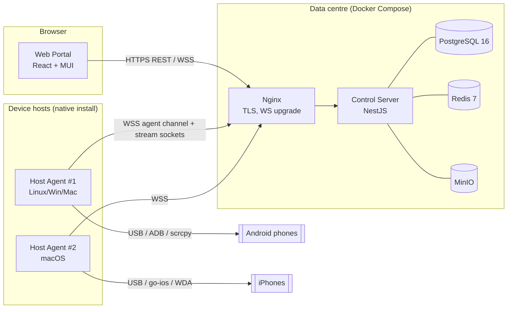

# DeviceLab — Architecture

DeviceLab is an on-premises remote mobile device lab. QA engineers reserve a real
Android or iOS phone, see its screen live in the browser, control it, install
builds, read logs and capture artifacts. Everything runs inside the customer's
network: no third-party cloud calls.

## 1. Components



| Component      | Path                    | Responsibility                                                                                   |
| -------------- | ----------------------- | ------------------------------------------------------------------------------------------------ |
| Web Portal     | `apps/portal`           | Inventory, reservations, live session UI, admin                                                  |
| Control Server | `apps/server`           | Auth/RBAC, inventory state, reservations, session brokering, binary stream relay, audit, storage |
| Host Agent     | `apps/host-agent`       | Device discovery, scrcpy/WDA lifecycle, frame capture, input injection, installs, logs, cleanup  |
| shared-types   | `packages/shared-types` | Enums, DTOs, permission matrix, **typed WebSocket contracts** (Zod schemas)                      |
| protocol       | `packages/protocol`     | Binary frame format for video + input, scrcpy control message encoders, H.264 SPS parser         |
| ui             | `packages/ui`           | MUI theme, `DeviceCard`, `StatusChip`, `ScreenViewer`, `LogPanel`                                |

## 2. Channels

There are three kinds of connection, and they are kept separate on purpose:

1. **REST** (`/api/*`). CRUD, auth, reservations, uploads. JWT bearer.
2. **JSON control channels** (Socket.IO):
   - `/portal` namespace: inventory updates, reservation and idle warnings, log
     lines, install progress. Authenticated with the access JWT.
   - `/agent` namespace: host registration, heartbeats (5 s), device events,
     commands from the server (start stream, install, cleanup, screenshot,
     logcat), each with a typed ack. Authenticated with a per-host token.
3. **Binary stream sockets** (plain WebSocket, `/ws/stream/*`, no JSON):
   - `/ws/stream/agent?sessionId=…` opened by the agent once the server sends
     `stream:start`.
   - `/ws/stream/portal?ticket=…` opened by the browser. The ticket is a
     60-second JWT that the server issues for one session and one role
     (`controller` or `observer`).
   - The server relays frames between them with no transcoding. Video goes
     agent → all viewers. Input goes controller → agent; **frames from observers
     are dropped** (single-writer rule).

Each binary message is one frame of `packages/protocol`:

```
 0      1      2      3      4 ...
+------+------+------+------+---------------------------+
| ver  | type | flags| rsvd |  type-specific body       |
+------+------+------+------+---------------------------+
```

| Type                    | Dir | Body                                                     |
| ----------------------- | --- | -------------------------------------------------------- |
| `VIDEO_CONFIG` 0x01     | A→P | codec u8, width u16, height u16, Annex-B SPS/PPS         |
| `VIDEO_FRAME` 0x02      | A→P | pts u64 (µs), Annex-B access unit; flag bit0 = keyframe  |
| `MJPEG_FRAME` 0x03      | A→P | width u16, height u16, JPEG                              |
| `PING`/`PONG` 0x0E/0x0F | P↔A | seq u32, t u64 (ms) — round-trip latency measurement     |
| `TOUCH` 0x20            | P→A | action u8, pointer u8, x u16, y u16 (normalised 0‥65535) |
| `KEY` 0x21              | P→A | action u8, key u16 (`DeviceKey`), meta u32               |
| `TEXT` 0x22             | P→A | UTF-8                                                    |
| `SCROLL` 0x23           | P→A | x u16, y u16, dx i16, dy i16                             |
| `CLIPBOARD` 0x24        | P→A | paste u8, UTF-8                                          |
| `ROTATE` 0x25           | P→A | —                                                        |
| `REQUEST_KEYFRAME` 0x26 | S→A | —                                                        |

The browser sends coordinates normalised to the visible frame, so the portal
never needs to know the device's pixel size. The agent maps them onto the
current encoder frame size (scrcpy rejects touches whose `screenW/H` differ from
the frame being streamed).

**WebRTC readiness.** The portal talks to an `StreamTransport` interface
(`connect / onFrame / send / close`). Today it is `WsRelayTransport`. A later
`WebRtcTransport` can carry the same frames over a DataChannel (or the H.264 over
an RTP track) portal↔agent, with signalling over the existing JSON channel.
Nothing in the UI has to change.

## 3. Live session sequence (Android)

```mermaid
sequenceDiagram
  participant U as Portal
  participant S as Server
  participant A as Agent
  participant D as Phone
  U->>S: POST /api/reservations {deviceId, minutes}
  S->>S: Redis SET lock:device NX PX; DB row; audit
  S-->>U: reservation
  U->>S: POST /api/sessions {reservationId}
  S->>A: stream:start {sessionId, deviceId, quality}
  A->>D: push scrcpy-server.jar, adb forward, app_process …
  A->>S: WS /ws/stream/agent?sessionId
  S-->>U: {sessionId, ticket}
  U->>S: WS /ws/stream/portal?ticket
  S->>A: REQUEST_KEYFRAME
  D-->>A: H.264 (scrcpy video socket)
  A-->>S: VIDEO_CONFIG / VIDEO_FRAME
  S-->>U: relay → WebCodecs VideoDecoder → canvas
  U->>S: TOUCH / KEY / TEXT
  S->>A: relay (controller only), touch activity → Redis
  A->>D: scrcpy control messages
```

Release (manual, expiry, idle or force) → `device:cleanup` → the agent stops the
stream, uninstalls the packages installed during the session (except the
allowlist), clears the clipboard, presses Home and optionally reboots →
the device becomes `AVAILABLE` again.

## 4. Reservations, locks and timeouts

- **Lock.** `lock:device:{id}` = reservationId, `SET NX PX`, with a TTL equal
  to the reservation length plus a grace period. The DB `Reservation` row is the
  record; Redis stops two people racing for the same device.
- **Activity.** Every input frame from the controller updates
  `activity:{reservationId}` (throttled to one write per second).
- **Sweeper.** Every 15 s the server evaluates each active reservation with the
  pure function `evaluateReservation()`: `OK | WARN_IDLE | RELEASE_IDLE |
RELEASE_EXPIRED`. A warning reaches the user over the portal channel with a
  "Still here?" prompt; any input or "extend" resets it.
- Defaults (env-configurable): 30-minute reservation, 5-minute idle warning,
  10-minute idle release, maximum 120 minutes per reservation.

## 5. Host Agent design

```
DeviceManager ─┬─ AndroidDriver (adbkit track-devices, scrcpy-server, logcat, pm)
               ├─ IosDriver     (go-ios + WDA — Phase 2)
               └─ MockDriver    (--mock: 3 Android + 2 iOS, synthetic screen)
          all implement DeviceDriver { list/watch, startStream, sendInput,
          install, uninstall, listApps, screenshot, logs, cleanup, reboot }
ServerLink   — Socket.IO client, reconnects with exponential backoff, heartbeat 5 s
StreamLink   — one binary WebSocket per active session
Health       — GET /health on localhost
```

- scrcpy-server **v3.3.1** (pinned; the version string must match the jar).
  Video over a forwarded `localabstract:scrcpy_<scid>` socket, with 12-byte
  packet headers (bit 63 = config, bit 62 = key frame). Control over the second
  socket.
- A watchdog restarts scrcpy if no frame arrives for 5 s while the device is
  awake. (scrcpy only emits frames on change, so the agent asks for a
  `RESET_VIDEO` after 5 s of silence and only treats a missing response as a
  stall.)
- The mock driver draws a small home screen in JS (status bar, app grid, touch
  trails, typed text). Android mocks pipe raw RGBA through `ffmpeg` (libx264,
  zerolatency) to produce real H.264 when ffmpeg is installed, and fall back to
  MJPEG otherwise. iOS mocks use MJPEG, which is what real WDA produces.

## 6. Security model (summary — see SECURITY.md)

- TLS at Nginx; agents connect over `wss://`.
- argon2id password hashes; 15-minute access JWT; 7-day refresh token that
  rotates on each use and is stored hashed, with reuse detection (reusing a
  token revokes its whole family).
- `@Permissions()` decorator + `PermissionsGuard` on every route; the same
  permission check (`can(role, perm)`) on every Socket.IO event and stream
  socket.
- Per-host agent tokens (shown once, stored as SHA-256), which admins can revoke.
- Every security-relevant action writes an `AuditLog` row.

## 7. Repository layout

See the root `README.md` and `CLAUDE.md`.

---

## 8. Task breakdown

### Phase 0 — Foundation

- [x] Turborepo + pnpm workspace, strict TS presets, ESLint/Prettier, Husky + lint-staged
- [x] `shared-types`: enums, DTOs, permission matrix, Zod-typed WS contracts
- [x] Prisma schema for every model in the spec + migration + seed (admin, teams, projects)
- [x] NestJS skeleton: config validation, Prisma, Redis, Helmet, rate limiting, Swagger at `/api/docs`
- [x] Auth: login / refresh (rotating) / logout / me; argon2; JWT guard; `@Permissions()` guard
- [x] Audit service (login, admin changes)
- [x] Docker Compose (Postgres, Redis, MinIO, server, portal+nginx with TLS)
- [x] Portal: MUI theme (light/dark, Inter), login page, layout shell (collapsible nav, top bar, project switcher, user menu, footer)
- [x] `CLAUDE.md`, README, docs

### Phase 1 — Android MVP

- [x] Host registration with per-host tokens (admin creates a host and gets the token once)
- [x] Agent: config file, ServerLink (backoff, heartbeat), `/health`, pino, graceful shutdown, banner
- [x] Agent `AndroidDriver`: track-devices, properties, battery, scrcpy-server lifecycle, H.264 demux, control mapping, install (`pm install -r -g`), apps list, logcat, screencap, cleanup, reboot
- [x] Agent `MockDriver` (`--mock`): 3 Android + 2 iOS
- [x] Server: hosts and devices modules, live inventory over `/portal`, admin device actions
- [x] Reservations: use-now, extend, release, force-release, Redis lock, idle sweeper, cleanup handshake
- [x] Sessions + stream relay with the single-writer rule, stream tickets, keyframe on join
- [x] Builds (minimal): upload APK → storage (MinIO or local filesystem) with SHA-256 → install to device
- [x] Artifacts: screenshots in storage, audited downloads
- [x] Portal inventory: grid/table, filters, search, live updates, admin actions
- [x] Portal session: ScreenViewer (WebCodecs + JMuxer fallback + MJPEG), input mapping, hardware toolbar, shortcuts, quality selector, FPS/latency, idle warning, FLAG_SECURE hint, Apps/Logs/Info tabs, drag-and-drop install, screenshot
- [x] Tests: protocol, reservation logic, RBAC guard; Playwright login → reserve → session (mock agent)

### Later phases

See section 9 of the build brief: iOS (Phase 2), build library, recording and
Appium (Phase 3), enterprise SSO and dashboards (Phase 4).
